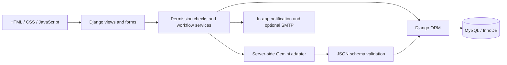
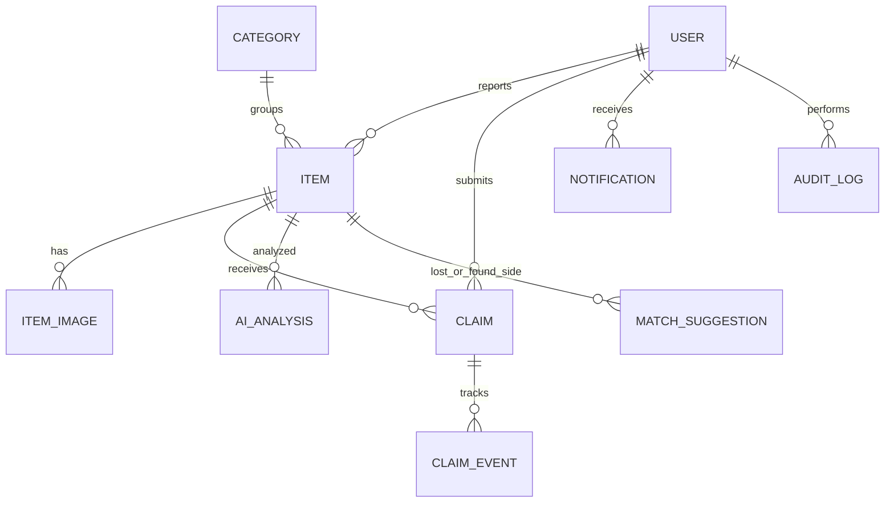

# Lost & Found Item Management System

A functional Django/MySQL academic MCA project with a responsive user workspace,
custom administration portal, private ownership verification, and server-side
Google Gemini integration. The product name in the interface is **Lost & Found Hub**.

## New: search for a lost item using a photo

If Gemini fails, run `python manage.py check_ai`. It now reports a specific safe
error code and tests synthetic image input with structured JSON. See
`GEMINI_TROUBLESHOOTING.md` for the full diagnosis and upgrade steps.

Open **AI matches → Search by image**, or use **Search by image** in the sidebar.
Any signed-in user can upload a photo without first filing a lost report. Optional
category and location filters narrow the search. After permission to send the photo
to Gemini, the server extracts visual features, selects up to 12 likely candidates,
and compares the actual search photo with actual found-item photos in one comparison
request. It displays similarity scores, reasons, item details, and claim links.

Only **FOUND** reports with a photo and status **APPROVED** or **MATCHED** qualify.
Pending, rejected, closed, claimed, returned, lost-type, and the searcher's own
reports are excluded. The optional demo records have no uploaded photographs:
add real item photos before expecting image-search results.

Enable this feature in your local `.env` and restart the Django server:

```dotenv
AI_ENABLED=True
GEMINI_API_KEY=your-own-valid-google-gemini-api-key
GEMINI_MODEL=gemini-2.5-flash
```

An API key with model access and available quota is required. The shipped example
leaves AI disabled deliberately. The UI now distinguishes disabled/unconfigured AI,
failed requests, no eligible reports, and no close matches. No fabricated results
or offline visual-identity claims are substituted for Gemini.

Search images are validated (one JPG/PNG/WEBP, 5 MB maximum), resized and stripped
of image metadata before sending, and not persisted as reports or public media.
Five searches per user per 15 minutes limit API usage. Results scoring below 60 are
not shown as close matches. Scores are model estimates, not calibrated probabilities
or proof of ownership. Administrators must still verify claims.

This is a bounded candidate search: when more than 12 reports qualify, category,
brand and color rank candidates before recent-report tie breaking. The page shows
the eligible and compared counts and asks users to refine filters. A missing result
does not prove that the item is absent. Two synchronous API calls may take roughly
120 seconds in the timeout case (temporary server retries can add time). Direct multimodal input follows
[Google's image-understanding documentation](https://ai.google.dev/gemini-api/docs/image-understanding).

### Updating an existing installation

Back up your database and project. Extract the new ZIP and replace source files,
preserving your existing `.env`, `media/`, and database. Do not copy the workspace
test environment or test database. This update adds no database migrations and no
new dependencies beyond the existing requirements. Run `pip install -r requirements.txt`,
`python manage.py migrate`, and restart Django. If you serve collected static files,
run `python manage.py collectstatic --noinput`. Existing reports and claims remain
in your database. The new route is `/matches/image-search/`.

## Quick start on Windows

Install **64-bit Python 3.12** from python.org and **MySQL 8.0.16+** (8.4 LTS is also
suitable). Use a normal Windows Python installation rather than MSYS Python.
Open PowerShell in the extracted `lost_and_found` folder.

```powershell
python -m venv venv
venv\Scripts\activate
python -m pip install --upgrade pip
pip install -r requirements.txt
python setup_env.py
```

If PowerShell blocks activation, use `venv\Scripts\python.exe` instead of `python`
and `venv\Scripts\python.exe -m pip` instead of `pip`; changing system-wide script
execution policy is unnecessary.

`setup_env.py` copies `.env.example` to `.env` and generates a unique secret. It
refuses to overwrite an existing `.env`. There are **no embedded real credentials**,
default administrator passwords, database dumps, or API keys in this project.

### 1. Create the MySQL database

Connect using MySQL Workbench or `mysql -u root -p`. Run the following SQL,
replacing the sample password with one you choose:

```sql
CREATE DATABASE lost_found_db
  CHARACTER SET utf8mb4 COLLATE utf8mb4_unicode_ci;
CREATE USER 'lost_found_app'@'localhost'
  IDENTIFIED BY 'replace-with-your-own-database-password';
GRANT ALL PRIVILEGES ON lost_found_db.* TO 'lost_found_app'@'localhost';
```

The application uses InnoDB transactions and row locks for competing claims.
Use a dedicated application account, not the MySQL root account. These privileges
support local migrations; production can separate migration and runtime accounts.

### 2. Configure `.env`

Keep the generated `SECRET_KEY`, then set:

```dotenv
DEBUG=True
ALLOWED_HOSTS=127.0.0.1,localhost
DB_ENGINE=mysql
DB_NAME=lost_found_db
DB_USER=lost_found_app
DB_PASSWORD=your-own-database-password
DB_HOST=127.0.0.1
DB_PORT=3306
TIME_ZONE=Asia/Kolkata

AI_ENABLED=False
GEMINI_API_KEY=
GEMINI_MODEL=gemini-2.5-flash

EMAIL_HOST=
EMAIL_PORT=587
EMAIL_HOST_USER=
EMAIL_HOST_PASSWORD=
EMAIL_USE_TLS=True
DEFAULT_FROM_EMAIL=lostfound@example.com
CONTACT_EMAIL=admin@example.com
SITE_URL=http://127.0.0.1:8000
```

Quote dotenv values containing `#`, spaces, or other special characters. Never
commit `.env`, media, or database backups. The supplied `.gitignore` excludes them.
MySQL is the default. `DB_ENGINE=sqlite` is available only for a quick local smoke
test; it does not replace the MySQL concurrency guarantees or acceptance tests.

### 3. Migrate and create the administrator

```powershell
python manage.py makemigrations
python manage.py migrate
python manage.py createsuperuser
python manage.py runserver
```

Migrations are already included, so `makemigrations` normally reports no changes.
Migration `items/0002_seed_categories.py` creates the 13 initial categories.

Open **http://127.0.0.1:8000/**. If another application uses that port:

```powershell
python manage.py runserver 127.0.0.1:8017
```

The administrator signs in at `/accounts/login/` and is sent to `/portal/`.
The development Django admin is at `/django-admin/`; operational item and claim
models are read-only there so decisions use the audited custom portal.

### 4. Optional demonstration records

```powershell
python manage.py seed_demo
```

This prompts for a strong password you choose, then creates:

| Username | Role |
|---|---|
| `demo.member` | User reporting lost items |
| `demo.finder` | User reporting found items |
| `demo.admin` | Independent administrator |

Nine sample reports are explicitly labeled `[Demonstration record]`. All counters
are computed from those database rows. No fabricated AI suggestions are seeded.
The command refuses to overwrite existing demo accounts. `DEMO_PASSWORD` may be
supplied through a private environment variable for automated local setup.

## Application walkthrough

1. Register an ordinary account, accepting the community terms. The form validates
   unique email/username, phone, password strength, and confirmation.
2. Report a lost or found item. Upload up to six images. Put secret markings,
   serial numbers, contact details, and holding location in private fields.
3. The report is saved as `PENDING`. AI feature extraction is attempted if enabled;
   failure never discards the report. The user receives an in-app notification.
4. An administrator reviews the report and approves or rejects it with remarks.
   Only approved reports enter community search and match generation.
5. A different member searches or follows an AI suggestion and submits a claim
   with meaningful ownership evidence. Uploading a receipt photograph is optional.
6. An independent administrator reviews the found report, private evidence,
   claimant answers, status history, and advisory AI consistency analysis.
7. The administrator may mark `UNDER_REVIEW` to request further in-person
   verification, then `APPROVED` or `REJECTED`. Remarks appear in the claim timeline.
8. Approval reserves the item and rejects competing pending claims, with audit
   entries and notifications. The administrator records `RETURNED` after handover.
9. Returned items disappear from available-item search and active suggestions.
   Historical returned items remain accessible through the explicit status filter.
10. Administrators can export filtered CSV summaries and report rows.

Use separate browser profiles/private windows when demonstrating finder,
claimant, and administrator roles simultaneously. Ordinary users cannot open
admin URLs manually. Staff cannot decide claims involving their own report or
their own claimant account.

## Architecture and modules

This is a server-rendered application, not a frontend mockup. Django forms and
ORM queries power each screen. Vanilla JavaScript enhances forms, previews,
notifications, charts, themes, loading feedback, and confirmation dialogs.

| Module | Responsibility |
|---|---|
| `config` | Environment configuration, MySQL, URL routing, ASGI/WSGI |
| `accounts` | Custom user, profile, login/logout, persistent login throttling, reset flow |
| `items` | Categories, lost/found reports, protected images, search, moderation services |
| `claims` | Ownership evidence, transition rules, row-lock concurrency, timeline |
| `notifications` | Scoped inbox, unread counts, mark-read endpoints, safe SMTP delivery |
| `ai_module` | Gemini adapter, JSON validation, candidate filtering, stored suggestions |
| `dashboard` | User and administrator portals, user/category management, charts |
| `reports` | Filtered aggregate reports and CSV export with formula protection |
| `core` | Audit trail, contact requests, upload validation, shared authorization |

User profile fields are stored directly on the custom `User`, avoiding an
unnecessary one-to-one profile join. Reports are live ORM aggregates rather than
redundant persisted report snapshots. A single `Item` distinguishes `LOST` and
`FOUND`. `PROJECT_TREE.txt` contains the complete generated directory structure.





### Workflow rules

* Reports begin pending and may be approved or rejected. Eligible approved
  reports can be marked matched, returned, or closed by staff. Closing/rejecting
  removes inappropriate reports from public availability while preserving history.
* Owners can edit pending, approved, or rejected reports only if no active claim
  exists. Editing or removing an image returns a report to pending and invalidates
  its previous AI results and suggestions.
* Claims transition from pending to under review/approved/rejected/cancelled;
  approved claims can transition to returned. Only claimants cancel their own
  pending or under-review claims.
* All claim writes acquire a row lock on the parent item. Duplicate active claims
  from one user and simultaneous competing approvals are prevented under MySQL.
* Match scores are bounded to 0–100; lost/found pairs are unique. AI never updates
  approval status. Potential duplicates are only flagged, never deleted.
* Initial duplicate screening checks same user/type/date/location, title or
  description similarity, and a small image average hash. This is a review aid,
  not a reliable object-identity or ownership detector.

## Gemini configuration

Obtain a Gemini API key from [Google AI Studio](https://aistudio.google.com/),
then set it in `.env` and restart Django:

```dotenv
AI_ENABLED=True
GEMINI_API_KEY=your-key
GEMINI_MODEL=gemini-2.5-flash
```

Choose a model available to your account; model availability and quotas can change.
The adapter uses the REST `generateContent` endpoint and `responseJsonSchema`,
described in [Google's official API reference](https://ai.google.dev/api/generate-content).
It sends the API key in a server-side header, never browser JavaScript.

`ai_module/services/gemini_service.py` implements:

* `analyze_item_image()` and `extract_item_features()` — object, category, colors,
  brand/model, material, shape, text, logos, patterns, and distinctive visual marks.
* `predict_category()` — suggested category, without silently changing user input.
* `compare_items()` — public metadata plus extracted public image features.
* `analyze_claim_consistency()` — administrator-only evidence consistency report.
* `generate_match_recommendations()` — bounded candidate comparison.

Candidates are opposite-type approved/matched reports in the same category within
90 days, ranked using brand, color, location, and title. At most five candidates
are compared per report. Scores of at least 60 produce stored suggestions and
notifications. Suggestions use public facts; private serial numbers and identifying
details are excluded from member-facing matching prompts. Private evidence is
used only by claim consistency analysis, whose output is visible only to staff.
No face identification is requested. Uploaded content is treated as untrusted data.

All responses are independently schema-validated, with bounded response size and
5-second connect/60-second read timeouts (configurable with `GEMINI_TIMEOUT_SECONDS`). Users can inspect suggested features and
correct their own report; the model never overwrites entered fields.

AI calls run synchronously for this academic implementation. Multiple candidate
comparisons can take time, and the UI shows loading feedback. For larger deployments,
move the existing service functions into an authenticated task queue and add quotas.
After outages or when enabling AI on existing approved records, retry a bounded batch:

```powershell
python manage.py retry_ai --limit 20
```

Without a key, invalid JSON, unavailable models, quota errors, or timeouts produce
an unavailable result. Normal reporting, searching, claims, and notifications remain
usable. Live Gemini was not called during generation; tests mock provider responses.

## SMTP and password reset

Set your institution's SMTP host, username, password, port, TLS setting, and verified
sender in `.env`. Restart the application after changes. `CONTACT_EMAIL` receives
contact-form notifications; the actual messages are also retained in the admin portal.

With `EMAIL_HOST` empty, password-reset emails print to the server console for
development. With SMTP configured, Django sends real reset emails. Reset tokens
expire after one hour and become invalid after successful use. Unknown accounts
receive the same browser response. Request throttling reduces reset-email abuse.

Important report and claim decisions attempt SMTP delivery after the database
transaction commits. Delivery failure preserves the in-app notification and writes
a generic server log message. There is no durable outbound email retry queue.
This is not a verified email-delivery setup until you supply working SMTP credentials.

## Privacy and security

* Django password hashing and validators; at least eight characters with upper,
  lower, numeric, and special characters. No plaintext password persistence.
* Username/email sign-in, session rotation, safe local `next` redirects, POST logout,
  CSRF, autoescaped templates, ORM queries, and server-side validation.
* Persistent database-backed account throttling: five failed attempts per account
  and thirty per source address per 15 minutes. It uses the direct remote address;
  configure a trusted proxy deliberately before relying on per-IP limits in production.
* Staff-only custom admin endpoints. User-scoped report editing, claims, evidence,
  profile, and notifications. Blocking an account prevents subsequent authentication.
* Private fields are not serialized to community pages. Files have random filenames
  and are served through permission-checked Django endpoints; there is **no open
  media route**. Never configure your reverse proxy to expose the `media/` directory.
* JPG/JPEG/PNG/WEBP only, maximum 5 MB each, six images per report, real Pillow format
  verification, extension/content checks, and a 25-million-pixel limit. Supporting
  evidence is an image or receipt photograph, not an arbitrary PDF/executable upload.
* Audit records cover registration, login, profiles, report and claim changes,
  category/user administration, notifications, and CSV export.
* CSV cells beginning with spreadsheet formula characters are escaped.
* In production, generic errors hide tracebacks. The 500 handler does not query
  the database while handling a database outage.

Private does not mean encrypted-at-rest: configure encrypted storage/backups for
your deployment. Define institution-specific retention, deletion, consent, and
handover policies before public use. Replaced/deleted file records may leave
unreferenced files on disk; include controlled orphan cleanup in your retention process.

### Production settings

Set `DEBUG=False`, a unique secret, exact allowed hosts, HTTPS, real SMTP, and a
least-privileged database account. This enables secure session/CSRF cookies, HTTPS
redirect, HSTS, content-type protection, and clickjacking protection. Do not use
Django's development server as a public production server.

```powershell
python manage.py check --deploy
python manage.py collectstatic --noinput
```

Use a production WSGI/ASGI host behind TLS, serve only `staticfiles/` publicly,
and preserve protected upload views. Configure forwarded-protocol handling only
for a proxy you control. Back up MySQL and private media together. Google Fonts
enhances typography; system font fallbacks work when external access is unavailable.
Monthly charts aggregate by UTC month, avoiding a dependency on MySQL timezone
tables. Date-range filters use local timezone boundaries in Python.

## Tests and verification

Allow the development test account to create Django's separate test database:

```sql
GRANT ALL PRIVILEGES ON test_lost_found_db.* TO 'lost_found_app'@'localhost';
```

Then run:

```powershell
python manage.py test --verbosity 2
python manage.py check
python manage.py makemigrations --check --dry-run
```

The suite covers registration, login/email login/throttling, safe redirects, logout,
CSRF, password reset, profile validation, report forms, image validation/privacy,
search/filtering, claim privacy/transitions, moderation, notifications, categories,
CSV/date filters, XSS escaping, duplicate detection, AI schema validation, provider
failure handling, match creation, and concurrent claim submission/approval.

Gemini calls are mocked. Email uses a local-memory backend in tests. MySQL
concurrency tests deliberately skip on SQLite. Never run tests using a production
database account or point the test database at real data.

See `VERIFICATION.md` for the checks actually run on the delivered version.

## Troubleshooting

| Symptom | Resolution |
|---|---|
| `Set SECRET_KEY` error | Run `python setup_env.py`, or replace the placeholder in your existing `.env`. |
| MySQL access denied | Confirm the database username/password/host and that the account has grants for this database. |
| MySQL connection refused | Start the MySQL Windows service; check host and port. |
| `mysqlclient` install fails | Use 64-bit CPython 3.12 and current pip for a prebuilt wheel; otherwise install the documented MySQL client build prerequisites. |
| Tables missing | Run `python manage.py migrate`. Do not delete initial migrations. |
| No categories | Apply migration `items/0002_seed_categories.py`, or create categories in the admin portal. |
| Report not in search | Pending/rejected/closed reports are private. Approve it first; default search shows available reports only. |
| Cannot edit report | Active claims or terminal report status lock editing. Resolve the workflow in the admin portal. |
| Cannot approve claim | Use an independent staff account; the item must be available and the transition valid. |
| AI unavailable | Check `AI_ENABLED`, key, model access, quota, connectivity, and retry command. Reports remain saved. |
| Reset email missing | In development check the server console. For SMTP check sender verification, TLS/port, credentials, and spam folder. |
| HTTPS redirect locally | Use `DEBUG=True` for local HTTP development. Production should use HTTPS. |
| CSRF failure | Use the same origin, allow cookies, refresh the form, and do not remove CSRF middleware/tokens. |
| Blank images | Check private media storage and file permissions. Do not add an unrestricted media route. |
| Port already in use | Run `python manage.py runserver 127.0.0.1:8017`. |
| Tests cannot create DB | Grant privileges on `test_lost_found_db` to a development-only account. |

## Source listing

The ZIP contains all executable source files. `PROJECT_TREE.txt` lists every path.
The companion `SOURCE_CODE.md` outside this folder lists each file under an exact
`FILE: lost_and_found/...` heading with its complete contents for academic review.
